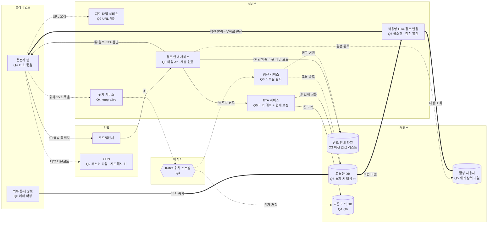

# ch03 미팅과제

> 시나리오: **S1 길동무** (국내 자동차 내비, DAU 2,000만, 출퇴근 위주, 15초 묶음 위치 전송)

> **한 줄 요약**: 계층 없는 경로 안내 타일 위에서 A\*로 탐색하고, 위치는 15초 묶음 → Kafka로 흘리며, 돌발 통제는 교통 DB 비용 무한대 + 웹소켓 점진 알림·우회로 분산으로 대응한다.

## 1. 전제

| 핵심 숫자 | 값 | 계산식 |
|---|---|---|
| 하루 경로 안내 시간 | 2억 분 | 2,000만 × 70분 / 7 |
| 위치 갱신 QPS (1초 / 15초 묶음 / 피크) | 12만 / 8,000 / 4만 | 2억 × 60 / 10⁵, ÷ 15, × 5 |
| 지도 데이터 트래픽 | 250TB/일 ≈ 2.5GB/s | 2억 분 × 1.25MB, ÷ 10⁵ |

- **교재와 다른 제약**: 국내 전용·출퇴근 위주로 규모가 교재의 1/25, 잘못된 경로 안내는 치명적이고 출퇴근 ETA 오차 ±3분 이내가 목표

## 2. 결정

| # | 결정 | 내 선택 | 근거 (한 줄) | 감수한 것 |
|---|---|---|---|---|
| Q1 | 규모 | 위치 갱신 피크 4만 QPS / 지도 2.5GB/s(일 250TB) | CDN 계층 대역폭으로 2.5GB/s는 크다 | — |
| Q2 | 지도 표시 | 미리 만든 래스터 타일(지오해시 키) + CDN / 지도 타일 서비스가 URL 계산 | 클라이언트가 계산하면 인코딩이 고정돼 바꾸려면 모든 플랫폼에 재배포해야 함 | — |
| Q3 ★ | 경로 탐색 | 경로 안내 타일(지오해시 격자, 이진 인접 리스트) + 탐색 중 이웃 타일 로드, 계층 없음 | 그래프 하나는 메모리 부담, 국내는 계층 없이도 충분 | 장거리 탐색 비용, 타일 크기 미정 |
| Q4 | 위치 갱신·저장 | 15초 묶음 + HTTP keep-alive / Kafka 스트림 → 교통·신규 도로·이력 서비스가 각자 저장 | 묶으면 QPS를 줄임, 연결 재수립 없음 / 필요한 서비스가 각자 저장 | 서버는 이탈을 최대 15초 늦게 앎 |
| Q5 | 적응형 ETA·경로 변경 | 재귀 상위 타일 저장 / 웹소켓 / 거리 기준 점진 알림 + 우회로 분산 (돌발) | 출발·목적지를 포함하는 타일까지 저장하면 바로 앎, 양방향이라 내비에 최적 / 한 번에 안 보내고 가까운 사람부터, 경로를 배분해 쏠림 완화 | 일부 사용자는 최적이 아닌 경로 |
| Q6 | 교통 반영·타일 갱신 | 이력 기반 예측 + 현재 교통 보정 / 영구 변경은 스트림 탐지 → 비동기 타일 갱신, 일시 통제는 교통 DB 비용 무한대 | 이력으로 빠르게 예측하고 교통으로 가감 / 폐쇄 확정은 외부 정보로만, 스트림은 탐지·이력 비교용, 통제 풀리면 비용 복구 | 타일 캐시 반영 방법 미정 |

> 돌발 상황(Q5): 금요일 18시 경부고속도로 서울 방향 사고로 전 차로 1시간 통제, 해당 구간 안내 중 사용자 30만 명
> 바뀐 결정: Q6-2 위치 스트림 비동기 갱신만 → 스트림 갱신 + 교통 DB 비용 무한대 조합

## 3. 전체 설계도

실선 = 경로 안내 요청 → 경로·ETA 응답 · 점선 = 쓰기·비동기 · 굵은 선 = 돌발 대응

**경로 안내 흐름**: ① 출발·목적지 요청 → ② 경로 안내 서비스 → ③ 경로 안내 타일을 탐색하며 이웃 타일 로드 → ④ 후보 경로를 ETA 서비스로 → ⑤ 이력 기반 예측 + 현재 교통 보정 → ⑥ 경로·ETA 응답(활성 사용자 등록)

## 4. 교재와 다르게 간 곳

| 결정 | 교재 | 나 | 이 시나리오에서 왜 |
|---|---|---|---|
| 경로 안내 타일 | 3계층(상·중·하) | 계층 없음 | 국내 출퇴근 위주라 경로가 짧다. 단, 장거리에 약하다 |
| 돌발 알림 | 영향 사용자에게 재계산 결과 전송 | 거리 기준 점진 알림 + 우회로 분산 | 30만 명 동시 재계산 폭주와 우회로 쏠림을 막기 위해 |
| 일시 통제 반영 | 갱신 서비스가 타일·교통 DB 갱신 | 타일은 그대로, 교통 DB 비용 무한대 | 1시간 통제에 타일 재생성은 느리다. 풀리면 비용만 복구 |

## 5. 미팅 안건

- **가장 자신 없는 결정**: Q3 계층 없이 간 것. 장거리(서울 → 부산) 탐색이 자신 없다
- **같이 이야기할 질문**: 일시 통제를 교통 DB 비용 ∞로만 반영하면, 교통을 보지 않는 최단 경로 캐시가 막힌 경로를 계속 후보로 내준다. TTL 말고 무엇으로 막나?
