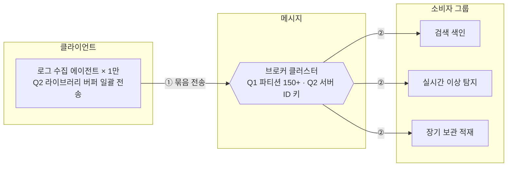

# 4장 분산 메시지 큐 — nashs789 · S1 로그창고

> **한 줄 요약**: 피크 1.5GB/s를 파티션 150개(+확장 여유)로 받고, 서버 ID를 키로 파티션을 정해 생산자 라이브러리 버퍼에서 일괄 전송한다. (복제·소비는 미진행)

## 1. 전제

| 핵심 숫자 | 값 | 계산식 |
|---|---|---|
| 피크 쓰기 처리량 | 1.5GB/s (150만 건/s) | 50만 건/s × 1KB = 500MB/s, × 3 |
| 필요한 파티션 수 | 150 (+확장 여유) | 처리량 1,500MB ÷ 10MB = 150 / 소비자 150만 ÷ 1만 = 150 |
| 저장량 | 하루 50TB · 2주 약 2.1PB | 500MB/s × 10⁵ / 50TB × 14 × 3(사본) |

- **교재와 다른 제약**: 로그 일부(0.1% 이하) 유실 허용 · 생산자(서비스 서버)가 느려지면 안 됨

## 2. 결정 4개

| # | 결정 | 질문 | 내 선택 | 근거 (한 줄) | 감수한 것 |
|---|---|---|---|---|---|
| Q1 | 규모 | 50만 건/s × 1KB, 피크 3배, 2주·사본 3이면 처리량·저장·파티션 수는? 가장 먼저 닿는 한계는? | 피크 1.5GB/s · 하루 50TB · 2주 2.1PB · 파티션 150(+확장 여유) / 한계는 B 네트워크(근거 보류) | 처리량·소비자 기준 모두 150, 확장을 생각하면 파티션을 늘려 두면 소비자를 늘릴 수 있다 | 먼저 닿는 한계를 판단하지 못함 |
| Q2 | 파티션 키·일괄 처리 | ① 서버 1만 대 로그를 어느 파티션에, 순서는 어디까지? ② 생산자는 어떻게 보내나? | ① B 서버 ID 키 ② B 생산자 라이브러리 버퍼 일괄 전송 | ① 업무별로 나누면 나중에 식별할 때 도움 ② 왕복 비용을 줄이고 디스크 순차 쓰기로 효율 | ② 지연 약간 증가 · ① 핫 파티션 검토 중 종료 |
| Q3 ★ | 복제와 ACK | 사본 몇 개를 어디에 두고, 생산자는 언제 ACK를 받나? | 미진행 | | |
| Q4 | 소비·전달 보장 | (돌발: lag 20분) ① 소비 방식과 그룹 구성은? ② 전달 방식과 오프셋 커밋 시점은? | 미진행 | | |

## 3. 시스템 전체 설계도

실선 = 메시지 발행 → 소비 · 점선 = 쓰기·비동기 · 굵은 선 = 돌발 대응

**메시지 발행 → 소비**: ① 에이전트 버퍼에서 서버 ID로 파티션을 정해 묶음 전송 → ② 소비자 그룹 3개가 각자 읽음 (복제·ACK·오프셋 커밋은 미진행)

## 4. 교재와 다르게 간 곳

교재와 같음 (키 기반 파티션 · 생산자 라이브러리 안의 버퍼·라우팅)

## 5. 미팅 안건

- **가장 자신 없는 결정**: Q1 — 뭐가 한계에 먼저 도달하는지 모르겠다
- **같이 이야기할 질문**: 순서가 "대략"이면 되는 로그에서 서버 ID 키(핫 파티션 위험)와 키 없음(순서 포기) 중 무엇이 맞나?
