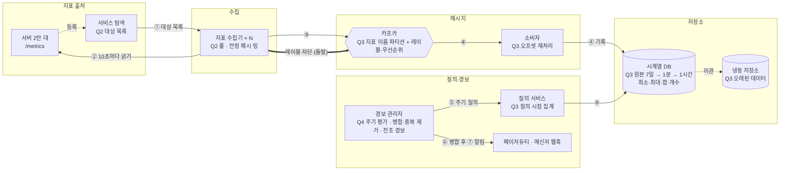

# 5장 지표 모니터링 및 경보 시스템 — 이인복 · S1 사내서버

> **한 줄 요약**: 풀 + 서비스 탐색 + 안정 해시 링으로 모아 카프카를 거쳐 시계열 DB에 쌓고, 경보는 질의 서비스로 주기 평가하며, 카디널리티 폭발은 수집기에서 레이블을 막는다.

## 1. 전제

| 핵심 숫자 | 값 | 계산식 |
|---|---|---|
| 초당 데이터 포인트 | 4×10⁵/s (활성 시계열 4×10⁶) | 2만 대 × 200 ÷ 10초 |
| 1년 전체 저장량 | 다운샘플링 후 ≈ 7.5TB (전 ≈ 234TB) | 하루 640GB × 7일 + 23일 ÷6 + 335일 ÷360 |

- **교재와 다른 제약**: 팀마다 레이블을 자유롭게 붙인다 → 시계열 수(카디널리티)가 먼저 한계 / 단일 데이터 센터·사내망이라 어디서든 접근 가능

## 2. 결정 4개

| # | 결정 | 질문 | 내 선택 | 근거 (한 줄) | 감수한 것 |
|---|---|---|---|---|---|
| Q1 | 규모·먼저 닿는 한계 | 서버 2만 × 지표 200, 10초 주기, 1년 보관이면 규모는? 무엇이 먼저 한계인가? | 4×10⁵ 포인트/s, 하루 640GB, 1년 7.5TB(원본 234TB) / C 시계열 수(색인) | 용량은 다운샘플링으로 크게 문제 안 됨, 레이블이 많아지면 시계열마다 색인이 생겨 부담 | 색인 구조는 아직 잘 모름 |
| Q2 ★ | 수집 방식 | 사내망 서버 2만 대(교체 적음)의 지표를 어떻게 모으고, 수집기 여러 대에 어떻게 나누며, 한 대가 죽으면? | 풀 + 서비스 탐색 + 안정 해시 링, 죽으면 링의 다음 수집기가 인수 | 사내망이라 전부 접근 가능, 교체가 적어 대상 관리 부담 작음, 파일 관리는 수동이라 탐색 서비스 | 수집기 장애를 감지할 때까지 해당 구간 지표 공백 |
| Q3 | 전송·데이터 줄이기 | ① 초당 4×10⁵ 포인트, 수집기와 시계열 DB 사이에 무엇을? ② 어디서 집계하고 다운샘플링은? | ① 카프카, 지표 이름 파티션 + 레이블·우선순위 ② 질의 시점 집계, 다운샘플링에 최소·최대·합·개수, 오래된 것은 냉동 저장소 | ① DB 장애 시 큐에 남아 오프셋으로 다시 읽음(1시간 ≈ 23GB), 지표별로 볼 수 있음 ② 병목은 어디든 생기니 질의 서비스에 복잡한 로직 넣기 편함, 과거 데이터와 비교 가능 | 질의 시점 집계는 긴 구간에서 느림, 카프카 운영 부담 |
| Q4 | 경보 평가·전달 | (돌발: `user_id` 레이블로 시계열 100배, 경보 5분 지연) ① 경보 규칙은 어디서 평가? ② 사고를 어떻게 막고 경보를 어떻게 줄이나? | ① 경보 관리자가 주기적으로 질의 서비스로 집계·임계값 비교 ② 수집기에서 문제 레이블 차단(돌발) + 병합·중복 제거 + 평균 이상 급등 시 전조 경보 | DB 이전에 막는 게 간단, 불필요하게 많아지는 메시지를 줄이는 게 중요, 임계값 전 전조 증상을 잡음 | 전조 경보만큼 평가 부하 증가, 차단 규칙은 미정 |

> 바뀐 결정: Q2 수집기 장애 대비 "MQ" → 해시 링 재배치 (꼬리 질문)

## 3. 시스템 전체 설계도

실선 = 지표 수집 → 경보 발령 · 점선 = 쓰기·비동기 · 굵은 선 = 돌발 대응

![[모니터링설계_이인복_2026-11-15.excalidraw]]

**지표 수집 → 경보 발령**: ① 수집기가 서비스 탐색에서 대상 목록 → ② 해시 링 구간별로 `/metrics` 10초마다 긁기(문제 레이블 차단) → ③ 카프카(지표 이름 파티션) → ④ 소비자가 시계열 DB에 기록 → ⑤ 경보 관리자가 주기적으로 질의 서비스로 집계·임계값 비교 → ⑥ 병합·중복 제거 → ⑦ 페이저듀티·웹훅 알림

## 4. 교재와 다르게 간 곳

| 결정 | 교재 | 나 | 이 시나리오에서 왜 |
|---|---|---|---|
| 다운샘플링 값 | 평균(표 5.4 → 5.5) | 최소·최대·합·개수도 보관 | 과거 데이터와 비교 가능 (평균만이면 급등이 사라짐) |
| 카디널리티 방어 | 다루지 않음 | 수집기에서 문제 레이블 차단 | 팀이 레이블을 자유롭게 붙임, DB 이전에 막는 게 간단 |
| 경보 규칙 | 임계값 위반 | 임계값 + 평균 이상 급등 시 전조 경보 | 임계값 전 전조 증상을 잡음 |

## 5. 미팅 안건

- **가장 자신 없는 결정**: 마지막 돌발 상황에서 경보가 지연되는 경우 어떻게 처리할지
- **같이 이야기할 질문**: 수집기의 레이블 차단은 허용 목록과 팀별 시계열 수 상한 중 무엇으로 하고, 누가 관리하며, 넘으면 수집을 거부할까 버릴까?
