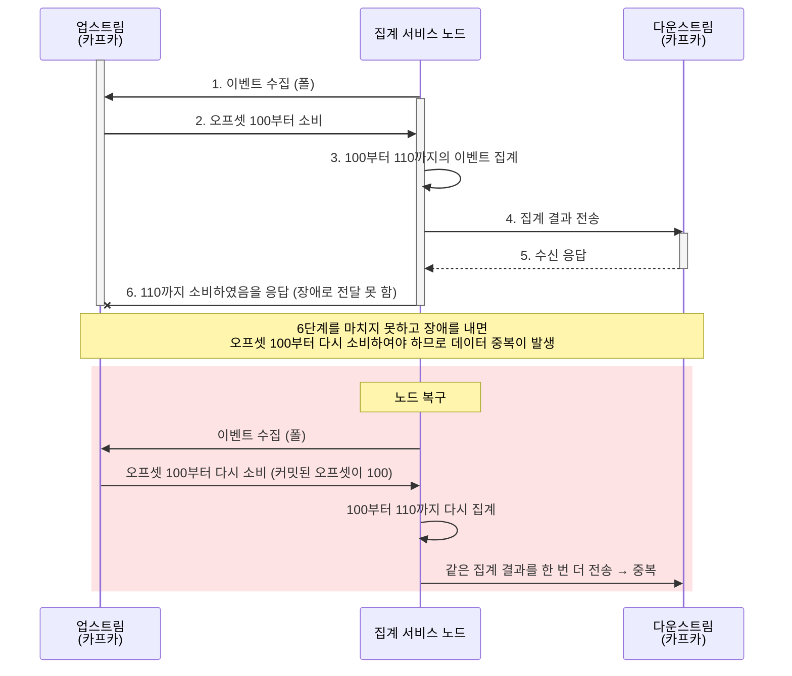
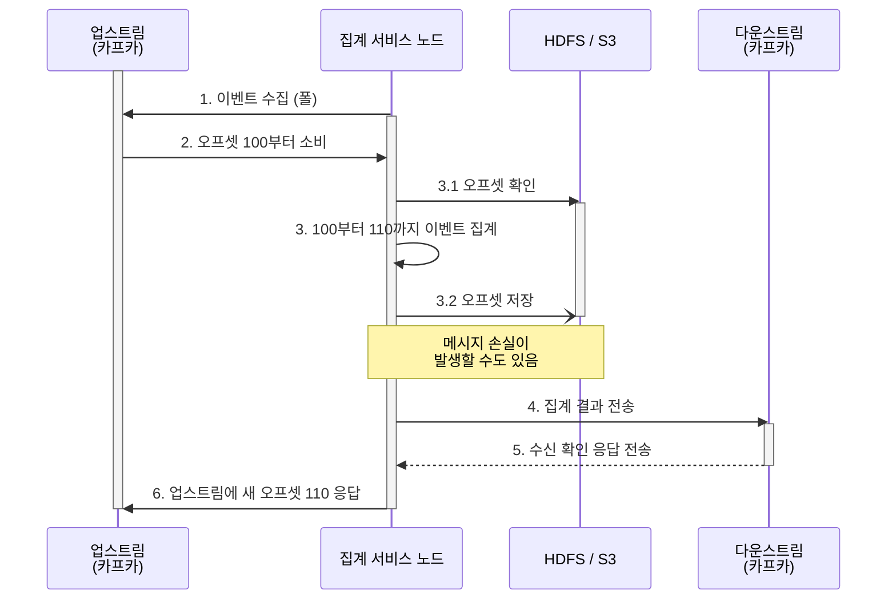
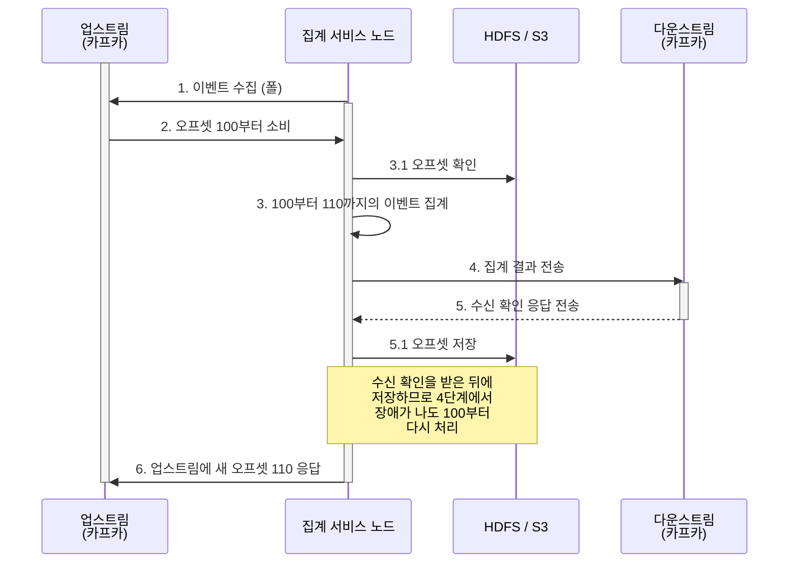
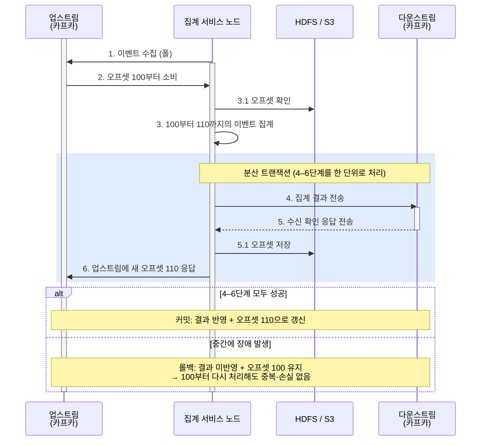

『가상 면접 사례로 배우는 대규모 시스템 설계 기초 2』 6장 광고 클릭 이벤트 집계를 정리한 첫 번째 글입니다.   
매일 10억 건씩 쏟아지는 광고 클릭을 몇 분 안에 정확하게 집계하는 시스템을 설계합니다.   
1부에서는 요구사항과 데이터 모델, 개략적 설계안까지 다룹니다.

온라인 광고의 핵심적인 혜택은 실시간 데이터로 광고 효과를 정량적으로 측정할 수 있다는 점입니다.   
온라인 광고의 핵심 프로세스는 실시간 경매(Real-Time Bidding, RTB)입니다.


광고 효과의 핵심 지표로는 클릭률(Click-Through Rate, CTR)과 전환율(Conversion Rate, CVR) 등이 있으며, 집계된 광고 클릭 데이터를 바탕으로 계산합니다.

## 1단계: 문제 이해 및 설계 범위 확정

### 면접에서 던지는 질문

- 입력 데이터는 무엇인가? (여러 서버에 분산된 로그 파일이며, 클릭 이벤트마다 `ad_id`, `click_timestamp`, `user_id`, `ip`, `country` 같은 속성이 들어 있다)
- 데이터 양은 어느 정도인가? (매일 광고 클릭이 10억 건 발생하고, 광고는 2백만 회 게재되며, 이벤트 수는 매년 30%씩 늘어난다)
- 가장 중요한 질의는 무엇인가?
    - 특정 광고에 대한 지난 M분간의 클릭 이벤트 수
    - 지난 1분간 가장 많이 클릭된 광고 100개 (질의 기간과 광고 수는 바꿀 수 있고, 집계는 매분 이루어진다)
    - `ip`, `user_id`, `country` 같은 속성으로 위 두 질의의 결과를 필터링할 수 있어야 한다
- 엣지 케이스(edge case)는 무엇인가? (예상보다 늦게 도착하는 이벤트와 중복된 이벤트가 있을 수 있고, 시스템 일부가 언제든 다운될 수 있으니 복구도 고려해야 한다)
- 지연 시간 요건은 어떻게 되는가? (모든 처리가 수 분 안에 끝나야 한다)

RTB와 광고 클릭 집계는 지연 시간 요건이 다릅니다.   
RTB는 응답성이 중요해서 지연 시간이 1초 미만이어야 합니다.   
광고 클릭 이벤트 집계는 주로 광고 과금과 보고에 쓰이므로 <mark>몇 분의 지연이 허용됩니다.</mark>

### 기능 요구사항

- 지난 M분 동안의 `ad_id` 클릭 수 집계
- 매분 가장 많이 클릭된 상위 100개 광고 아이디 반환
- 다양한 속성에 따른 집계 필터링 지원
- 데이터의 양은 페이스북이나 구글 정도

### 비기능 요구사항

- **정확성**: 집계 결과는 RTB와 광고 과금에 쓰이므로 정확해야 한다.
- **지연·중복 처리**: 지연되거나 중복된 이벤트를 적절히 처리할 수 있어야 한다.
- **견고성**: 부분적인 장애는 감내할 수 있어야 한다.
- **지연 시간**: 전체 처리 시간은 수 분을 넘지 않아야 한다.

### 개략적 추정

- DAU: 10억 명
- 사용자는 하루 평균 광고 1개를 클릭한다고 가정한다 (하루 10억 건).
- 광고 클릭 QPS = 10⁹(이벤트) / 10⁵(하루 86,400초를 근사한 값) = 10,000
- 최대 QPS는 평균의 5배인 50,000
- 광고 클릭 이벤트 하나에 0.1KB가 필요하다 (0.1KB × 10억 = 하루 100GB, 월 3TB).

## 2단계: 개략적 설계안 제시 및 동의 구하기

### 질의 API 설계

> [!tip]
> API 설계의 목적은 클라이언트와 서버 간의 통신 규약을 만드는 것입니다.

이 API를 쓰는 사람은 주로 데이터 과학자, 제품 관리자, 광고주이고, 이들이 대시보드를 볼 때 집계 서비스에 질의가 발생합니다.   
API는 다음 세 가지 기능을 지원해야 합니다.

- 지난 M분 동안 각 `ad_id`에 발생한 클릭 수 집계
- 지난 M분 동안 가장 많은 클릭이 발생한 상위 N개 `ad_id` 목록 반환
- 다양한 속성을 기준으로 집계 결과를 필터링하는 기능

#### 📌 API 1: 지난 M분간 각 ad_id에 발생한 클릭 수 집계

`GET /v1/ads/{:ad_id}/aggregated_count`

요청

| 인자명 | 뜻 | 자료형 |
|---|---|---|
| `from` | 집계 시작 시간 | long |
| `to` | 집계 종료 시간 | long |
| `filter` | 필터링 전략 식별자 | long |

응답

| 필드명 | 뜻 | 자료형 |
|---|---|---|
| `ad_id` | 광고 식별자 | string |
| `count` | 집계된 클릭 횟수 | long |

#### 📌 API 2: 지난 M분간 가장 많은 클릭이 발생한 상위 N개 ad_id 목록

`GET /v1/ads/popular_ads`

요청

| 인자명 | 뜻 | 자료형 |
|---|---|---|
| `count` | 상위 몇 개의 광고를 반환할 것인가 | integer |
| `window` | 분 단위로 표현된 집계 윈도 크기 | integer |
| `filter` | 필터링 전략 식별자 | long |

응답

| 필드명 | 뜻 | 자료형 |
|---|---|---|
| `ad_ids` | 광고 식별자 목록 | array |

### 데이터 모델

데이터는 원시 데이터(raw data)와 집계 결과 데이터(aggregated data) 두 종류로 나눌 수 있습니다.

#### 📌 원시 데이터

```text
[AdClickEvent] ad001, 2021-01-01 00:00:01, user 1, 207.148.22.22, USA
```

#### 📌 집계 결과 데이터

광고 클릭 이벤트가 매분 집계된다고 가정하면 다음과 같습니다.

| ad_id | click_minute | count |
|---|---|---|
| ad001 | 202101010000 | 5 |
| ad001 | 202101010001 | 7 |

광고 필터링을 지원하려면 `filter_id`가 추가됩니다.

| ad_id | click_minute | filter_id | count |
|---|---|---|---|
| ad001 | 202101010000 | 0012 | 2 |
| ad001 | 202101010000 | 0023 | 3 |
| ad001 | 202101010001 | 0012 | 1 |
| ad001 | 202101010001 | 0023 | 6 |

필터 테이블은 다음과 같이 구성합니다.

| filter_id | region | ip | user_id |
|---|---|---|---|
| 0012 | US | * | * |
| 0023 | * | 123.1.2.3 | * |

지난 M분 동안 가장 많이 클릭된 상위 N개의 광고를 반환하는 질의를 지원하려면 다음 구조를 사용합니다.

`most_clicked_ads`

| 필드명 | 자료형 | 뜻 |
|---|---|---|
| `window_size` | integer | 분 단위로 표현된 집계 윈도 크기 |
| `update_time_minute` | timestamp | 마지막으로 갱신된 타임스탬프 (1분 단위) |
| `most_clicked_ads` | array | JSON 형식으로 표현된 ID 목록 |

질의할 때마다 수십억 건의 데이터를 읽어 개수를 세고 정렬해 상위 광고를 고르면 서버에 부하가 큽니다.   
그래서 집계 서비스가 상위 N개를 미리 계산해 저장해 두고, 조회할 때는 행 하나만 읽습니다.

```sql
SELECT most_clicked_ads
  FROM most_clicked_ads
 WHERE window_size = 5
 ORDER BY update_time_minute DESC
 LIMIT 1;
```

집계 서비스는 매분 윈도를 1분씩 밀며 상위 N개를 다시 계산해 한 행씩 쌓고, 조회는 가장 최근 행 하나만 읽습니다.


#### 📌 비교

|  | 원시 데이터만 보관하는 방안 | 집계 결과 데이터만 보관하는 방안 |
|---|---|---|
| 장점 | 원본 데이터를 손실 없이 보관, 데이터 필터링 및 재계산 지원 | 데이터 용량 절감, 빠른 질의 성능 |
| 단점 | 막대한 데이터 용량, 낮은 질의 성능 | 데이터 손실 |

집계 결과 데이터만 보관할 때의 데이터 손실은 데이터가 깨진다는 뜻이 아닙니다.   
요약하는 과정에서 세부 정보가 사라져, 나중에 생긴 질문에 답할 수 없게 된다는 뜻입니다.


<mark>결론적으로는 둘 다 저장하는 것이 좋습니다.</mark>

- 문제가 생기면 원시 데이터를 디버깅에 활용할 수 있고, 집계 결과가 잘못되어도 원시 데이터로 결과를 다시 만들 수 있다.
- 원시 데이터는 양이 많아서 직접 질의하기에는 비효율적이다.
- 원시 데이터는 백업 데이터로 활용한다 (냉동 저장소, cold storage).
- 집계 결과 데이터는 활성 데이터 구실을 한다.

### 올바른 DB 선택

DB를 고를 때는 다음을 따져 봅니다.

- 데이터는 어떤 모습인가? 관계형 데이터인가, 문서 데이터인가, 이진 대형 객체(Binary Large Object, BLOB)인가?
- 읽기 중심인가, 쓰기 중심인가?
- 트랜잭션(transaction)을 지원해야 하는가?
- 질의 과정에서 OLAP(Online Analytical Processing, 대량의 데이터를 여러 기준으로 묶어 집계·분석하는 처리) 함수가 필요한가?

이 시스템은 QPS가 평균 10,000, 최대 50,000이라서 쓰기 중심 시스템입니다.   
그래서 이번 설계에서도 카산드라를 채택합니다.

> [!note] 여담
> 쓰기 연산에 강한 NoSQL로 카산드라를 계속 채택하는 게 신기하네.   
> 나는 이 책을 통해서 아파치 카산드라(Apache Cassandra)라는 이름을 처음 들어봤는데...

집계 데이터는 본질적으로 시계열 데이터이며, 이 데이터를 처리하는 워크플로는 읽기 연산과 쓰기 연산을 모두 많이 사용합니다.

- **읽기**: DB에 질의해 최신 집계 결과를 보여 주고, 대시보드를 갱신하고, 경보를 보내야 한다.   
  광고가 2백만 회 게재되니 읽기 연산이 많을 수밖에 없다.
- **쓰기**: 매분 데이터를 집계해 결과를 기록하므로 쓰기 작업이 빈번하다.

### 개략적 설계안

실시간 빅데이터 처리에서 데이터는 보통 끝없이 시스템에 흘러 들어왔다가 흘러 나갑니다.

- **입력**: 원시 데이터 (무제한 데이터 스트림)
- **출력**: 집계 결과


#### 📌 비동기 처리

생산자와 소비자를 동기 방식으로 연결하면, 둘의 처리 용량이 항상 같지는 않아서 좋은 방법이 아닙니다.   
트래픽이 갑자기 늘면 소비자의 처리 용량을 넘어 메모리 부족 오류가 발생할 수 있고, 동기식 시스템의 특성상 컴포넌트 하나의 장애가 전체 시스템 장애로 이어집니다.   
이를 해결하려고 메시지 큐(Message Queue, MQ)를 도입해 <mark>생산자와 소비자의 규모를 독립적으로 확장합니다.</mark>


두 개의 MQ를 사용하는 설계안입니다.   
이 글에서 MQ는 카프카(Kafka)를 기준으로 설명하고, 첫 번째 MQ를 MQ1, 두 번째 MQ를 MQ2라고 부릅니다.

1. 로그 모니터가 클릭 이벤트를 MQ1에 기록한다.
2. 원시 경로: DB 기록 프로세스가 MQ1의 이벤트를 그대로 원시 데이터 DB에 쓴다 (백업·재계산용).
3. 집계 경로: 데이터 집계 서비스가 MQ1의 이벤트를 읽어, 1분마다 두 가지 결과를 MQ2에 쓴다.
    - 분 단위로 집계된 광고 클릭 수
    - 분 단위로 집계한, 가장 많이 클릭된 상위 N개 광고
4. 또 하나의 DB 기록 프로세스가 MQ2에서 결과를 끌어와(폴) 집계 결과 DB에 쓴다.
5. 대시보드(질의 서비스)는 집계 결과 DB만 조회한다.


> [!info] ❓ 집계 결과를 왜 DB에 바로 쓰지 않을까?
> 정확히 한 번(exactly once) 처리를 보장하려면 원자적 커밋(atomic commit)이 필요하기 때문입니다.

> [!warning] 커밋 전에 장애가 나면
> 결과 쓰기와 오프셋 커밋을 한 트랜잭션으로 묶었으므로, 커밋 전에 장애가 나면 트랜잭션 코디네이터가 트랜잭션 전체에 ABORT 표시를 붙입니다.   
> 그래서 커밋된 것만 읽는 소비자(`read_committed`)에게 MQ2의 결과는 보이지 않고, 오프셋도 그대로 남습니다.   
> 재시작하면 마지막으로 커밋된 오프셋부터 같은 이벤트를 다시 처리합니다.

### 집계 서비스


광고 클릭 이벤트를 집계하는 좋은 방법 중 하나는 맵리듀스(MapReduce) 프레임워크를 쓰는 것입니다.   
맵리듀스를 표현하기 좋은 모델은 유향 비순환 그래프(Directed Acyclic Graph, DAG)입니다.

#### 📌 맵 노드(map node)


맵 노드는 조건에 따라 데이터를 보낼 노드를 결정합니다.

> [!info] ❓ 파티션이나 태그를 구성해 두고 집계 노드가 카프카를 바로 구독하면 안 될까?
> 입력 데이터를 전처리하거나 정규화해야 한다면 맵 노드가 필요합니다.   
> 데이터가 만들어지는 방식을 제어할 수 없다면, 같은 `ad_id`의 이벤트가 서로 다른 카프카 파티션에 들어갈 수도 있습니다.

#### 📌 집계 노드

집계 노드는 맵 노드가 보내 준 `ad_id`별 광고 클릭 이벤트 수를 매분 메모리에서 집계합니다.   
1분이 지나면 노드마다 자기가 맡은 광고 중 상위 N개를 골라 리듀스 노드로 보냅니다.   
맵리듀스 패러다임에서 보면 집계 노드는 사실 리듀스 프로세스의 일부입니다. (맵-리듀스-리듀스 프로세스로 볼 수 있습니다.)

두 번의 리듀스가 하는 일은 다음과 같습니다.

- **집계 노드 (첫 번째 리듀스)**: 클릭 이벤트 여러 건 → 광고별 클릭 수 → 노드별 상위 N개 후보
- **리듀스 노드 (두 번째 리듀스)**: 모든 노드의 상위 후보 → 전체 상위 N개

#### 📌 리듀스 노드

리듀스 노드는 모든 집계 노드가 보낸 상위 후보를 모아 클릭 수로 다시 정렬하고, 전체 상위 N개만 남깁니다.   
<mark>원본 이벤트가 아니라 노드별 상위 N개만 주고받으므로</mark> 리듀스 노드가 다룰 데이터가 적습니다.


DAG는 맵리듀스 패러다임을 표현하는 모델입니다.   
빅데이터를 입력으로 받아, 병렬 분산 컴퓨팅 자원을 활용해 작은 크기나 일반적인 크기의 데이터로 변환하도록 설계되었습니다.

이 모델의 중간 데이터는 메모리에 저장할 수 있습니다.   
노드 간 통신은 노드들이 서로 다른 프로세스라면 TCP로, 서로 다른 스레드라면 공유 메모리로 처리할 수 있습니다.

#### 📌 주요 사용 사례

책은 주요 사용 사례로 세 가지를 듭니다.   
클릭 수 집계는 섹션 처음의 첫 번째 그림 그대로입니다.   
맵 노드가 이벤트를 `ad_id`로 나눠 보내므로 같은 광고는 언제나 같은 집계 노드로 가고, 1분이 끝나면 각 집계 노드가 자기 몫의 광고 수를 내보냅니다.   
상위 N개 광고는 두 번째 그림과 앞의 집계 노드, 리듀스 노드에서 살펴봤으니, 여기서는 데이터 필터링만 짚고 넘어갑니다.

데이터 필터링은 국가 같은 필터링 기준별로 미리 집계해 저장해 두는 방식입니다.

| ad_id | click_minute | country | count |
|---|---|---|---|
| ad001 | 202101010000 | USA | 100 |
| ad001 | 202101010000 | GBR | 200 |
| ad001 | 202101010000 | others | 3000 |
| ad002 | 202101010000 | USA | 10 |
| ad002 | 202101010000 | GBR | 25 |
| ad002 | 202101010000 | others | 12 |

이런 기법을 스타 스키마(star schema)라고 부릅니다.   
데이터 웨어하우스(data warehouse)에서 널리 쓰이는 기법으로, 필터링에 쓰이는 필드는 차원(dimension)이라고 부릅니다.

장점은 다음과 같습니다.

- 이해하기 쉽고 구축하기 간단하다.
- 기존 집계 서비스를 재사용해 스타 스키마에 차원을 더 만들 수 있다 (추가 컴포넌트가 필요 없다).

  ```text
  기존:       (ad001, 12:00)          → 3300
  차원 추가:  (ad001, 12:00, USA)     → 100
              (ad001, 12:00, GBR)     → 200
              (ad001, 12:00, others)  → 3000
  ```

- 결과를 미리 계산해 두므로 필터링이 빠르다.

단점은 버킷(bucket)과 레코드가 많이 생긴다는 것입니다.   
여기서 버킷은 (`ad_id`, 분, 차원 값) 조합 하나에 대한 집계 칸입니다.   
차원이나 차원 값이 늘어날 때마다 조합 수만큼 곱으로 늘어납니다.

---
title: "[대규모 시스템 설계 2] 광고 클릭 이벤트 집계 시스템 설계 (2): 시간, 전달 보장, 규모 확장"
description: "가상 면접 사례로 배우는 대규모 시스템 설계 기초 2, 6장 2부. 람다·카파 아키텍처와 재계산, 이벤트 시각과 워터마크, 집계 윈도, 정확히 한 번 처리, 규모 확장과 핫스팟, 결함 내성과 모니터링을 정리했습니다."
category: backend
subcategory: system-design
created: 2026-11-21
tags: [system-design, ad-click, aggregation, stream-processing, watermark, exactly-once, lambda-architecture, kappa-architecture, kafka, cassandra, 면접]
series: system-design
series_order: 8
---

『가상 면접 사례로 배우는 대규모 시스템 설계 기초 2』 6장 광고 클릭 이벤트 집계의 두 번째 글입니다.   
1부에서는 요구사항과 데이터 모델, 두 개의 MQ로 나눈 원시·집계 경로, 맵리듀스 DAG로 만든 집계 서비스를 정리했습니다 → [[ad-click-event-aggregation-1]]   
2부에서는 시간 처리, 전달 보장, 규모 확장, 결함 내성까지 상세 설계를 이어서 정리합니다.

## 3단계: 상세 설계

### 스트리밍 vs 일괄 처리

|  | 서비스 (온라인 시스템) | 일괄 처리 시스템 (오프라인 시스템) | 스트리밍 시스템 (실시간에 가깝게 처리하는 시스템) |
|---|---|---|---|
| 응답성 | 클라이언트에게 빠르게 응답 | 클라이언트에게 응답할 필요가 없음 | 클라이언트에게 응답할 필요가 없음 |
| 입력 | 사용자의 요청 | 유한한 크기를 갖는 입력. 큰 규모의 데이터 | 입력에 경계가 없음 (무한 스트림) |
| 출력 | 클라이언트에 대한 응답 | 구체화 뷰, 집계 결과 지표 등 | 구체화 뷰, 집계 결과 지표 등 |
| 성능 측정 기준 | 가용성, 지연 시간 | 처리량 | 처리량, 지연 시간 |
| 사례 | 온라인 쇼핑 | 맵리듀스 | 플링크(Flink) |

개략적 설계안은 일종의 스트림 처리 시스템(stream processing system)입니다.   
이 설계안은 스트림 처리를 중심으로 하되, 재계산처럼 과거 데이터를 다룰 때는 일괄 처리도 함께 씁니다.


두 처리 경로를 동시에 지원하는 시스템의 아키텍처를 람다(Lambda) 아키텍처라고 부릅니다.


람다 아키텍처의 단점은 유지 관리해야 할 코드가 두 벌이라는 점입니다.   
이 두 경로를 하나로 합쳐 처리하는 것이 카파(Kappa) 아키텍처입니다.   
이 설계안은 카파 아키텍처에 가깝습니다.   
일괄 처리는 재계산할 때 원시 데이터를 한꺼번에 읽어 오는 데만 쓰고, 집계는 실시간 경로와 같은 집계 서비스가 맡기 때문입니다 (아래 데이터 재계산 참고).

### 데이터 재계산

이미 집계한 데이터를 다시 계산해야 할 때가 있습니다.   
예를 들어 집계 서비스에서 중대한 버그가 발견된 경우입니다.   
이럴 때는 버그가 발생한 시점부터 원시 데이터를 다시 읽어 집계 데이터를 재계산합니다.


1. 원시 데이터 저장소에서 데이터를 가져온다.   
   이 과정은 일괄 처리 프로세스를 따른다.
2. 추출된 데이터는 재계산 전용 집계 서비스로 보낸다. (실시간 데이터 처리와 과거 데이터 재계산이 서로 간섭하지 않게 하기 위해서다.)
3. 집계 결과는 두 번째 MQ로 전송되어 집계 결과 DB에 반영된다.

### 시간

집계를 하려면 타임스탬프가 필요합니다.

- **이벤트 시각**: 광고 클릭이 발생한 시각
- **처리 시각**: 집계 서버가 클릭 이벤트를 처리한 시스템 시각

네트워크 지연이나 비동기 처리 때문에 이벤트가 발생한 시각과 처리 시각 사이에 격차가 생길 수 있습니다.


같은 클릭이라도 실제로 클릭된 시각을 기준으로 하느냐, 서버에 도착한 시각을 기준으로 하느냐에 따라 다른 구간에 집계됩니다.

처리 시각을 집계에 쓰면 단순하지만, 집계 결과가 부정확할 수 있습니다.

1. 장애가 해결되고 집계 서비스가 재개되면, 큐에 쌓인 이벤트가 한꺼번에 처리되면서 갑자기 클릭이 폭증한 것처럼 보인다.
2. 재계산하면 처리 시각이 지금으로 바뀌어 처음 집계와 결과가 달라진다.   
   결과를 재현할 수 없으니 버그가 생겨도 추적할 수 없다.
3. 집계 결과가 네트워크 상태에 따라 바뀌므로 광고주에게 청구할 금액을 신뢰할 수 없다.

이벤트 발생 시각을 쓰면 결과는 정확하지만, 늦게 도착하는 이벤트를 잘 처리해야 합니다.

1. 언제 도착할지 모르는 이벤트를 계속 기다릴 수는 없다.
2. 집계 구간을 빨리 닫으면 이벤트를 놓치고, 오래 기다리면 결과는 정확하지만 그동안 그 구간의 집계를 메모리에 들고 있어야 한다.
3. 구간이 닫힌 뒤에 도착한 이벤트를 버릴지, 다시 계산할지도 정해야 한다.

이 시스템에서는 <mark>이벤트 발생 시각을 쓰는 것을 추천합니다.</mark>   
늦게 도착한 이벤트를 올바르게 처리하기 위해 일반적으로 워터마크(watermark)라는 기술을 사용합니다.


광고 클릭 이벤트를 1분 단위로 끊어지는 텀블링 윈도(tumbling window)로 집계하는 사례입니다.   
이벤트가 어느 윈도에 속하는지는 발생 시각으로 정하고, 윈도는 끝 시각이 되면 닫혀 결과가 확정됩니다.   
그래서 발생 시각으로는 윈도 1에 속하지만 윈도 1이 닫힌 뒤에 도착한 이벤트는 집계에서 빠집니다.   
몇십 초 늦었을 뿐인데 집계 결과가 실제보다 적어집니다.


워터마크는 윈도를 끝 시각에 바로 닫지 않고, 정해 둔 시간만큼 더 열어 두는 기법입니다.   
그림에서는 윈도마다 15초를 더 열어 두어, 늦게 도착한 이벤트도 원래 윈도에 집계합니다.   
워터마크를 얼마나 길게 둘지는 비즈니스 요구사항에 따라 정합니다.   
길게 둘수록 결과는 정확해지지만, 그만큼 결과 확정이 늦어집니다.   
워터마크 기법으로도 한참 뒤에 도착하는 이벤트는 집계할 수 없습니다.   
하지만 발생 확률이 낮은 이벤트를 처리하려고 시스템을 복잡하게 만들면 투자 대비 효능(Return on Investment, ROI)이 떨어집니다.

### 집계 윈도

- 텀블링 윈도(tumbling window) = 고정 윈도(fixed window)
- 호핑 윈도(hopping window)
- 슬라이딩 윈도(sliding window)
- 세션 윈도(session window)

이 설계안에서 다루는 것은 텀블링 윈도와 슬라이딩 윈도입니다.


텀블링 윈도는 시간을 같은 크기의 겹치지 않는 구간으로 나눠, 매분 발생한 클릭 이벤트를 집계합니다.


슬라이딩 윈도는 데이터 스트림 위를 미끄러지며 나아가, 같은 시간 구간 안에 있는 이벤트를 집계합니다.   
지난 M분간 가장 많이 클릭된 상위 N개 광고를 알아내기에 적합합니다.

### 전달 보장

집계 결과는 과금과 연결되므로 정확성과 무결성이 보장되어야 합니다.

- 이벤트 중복을 피해야 한다.
- 모든 이벤트의 처리를 보장해야 한다.

MQ는 세 가지 전달 방식을 지원합니다.

- 최대 한 번(at-most-once)
- 최소 한 번(at-least-once)
- 정확히 한 번(exactly-once)

세 가지 전달 방식은 [[distributed-message-queue-2#메시지 전달 방식]]에서 자세히 다뤘습니다.

#### 📌 중복 데이터 제거

중복 데이터는 두 가지 경우에 생깁니다.

- 클라이언트가 같은 이벤트를 악의적으로 여러 번 보내는 경우
- 집계 서비스 노드에 장애가 발생해 이벤트가 중복으로 집계되는 경우



집계 서비스 노드에 장애가 발생해 중복 데이터가 생기는 과정입니다.   
이를 해결하는 방법은 HDFS나 S3 같은 외부 파일 저장소에 오프셋을 기록하는 것입니다.

> [!note] 여담
> 장애를 대응하기 위해 외부 저장소를 쓰는데, 또 외부 저장소의 장애를 대비한 외부 서비스를 쓰고, 또 그 장애를 위해 외부 서비스를 대비하면 도대체 언제 끝나지?



이 설계에도 큰 문제가 있습니다.   
4단계에서 장애가 나 집계 결과를 보내지 못하면, 오프셋은 이미 110으로 저장되었으므로 100부터 110까지의 데이터가 손실될 수 있습니다.   
그래서 오프셋은 집계 결과의 수신 확인 응답을 받은 뒤에 저장해야 합니다.



이렇게 하면 데이터 손실은 막을 수 있지만, 중복은 다시 생길 수 있습니다.   
5단계에서 수신 확인을 받은 뒤 5.1단계에서 오프셋을 저장하기 전에 장애가 나면, 집계 결과는 이미 다운스트림에 들어갔는데 오프셋은 100에 남아 있습니다.   
복구한 노드는 100부터 다시 처리해 같은 결과를 한 번 더 보냅니다.   
결과 전송과 오프셋 저장 중 어느 쪽을 먼저 해도, <mark>둘 사이에 장애가 나면 손실이나 중복 중 하나가 생깁니다.</mark>   
그래서 장애가 생겨도 이벤트를 정확히 한 번만 처리하려면 4~6단계를 하나의 분산 트랜잭션(distributed transaction)으로 묶어야 합니다.   
1부 [[ad-click-event-aggregation-1#개략적 설계안]]의 "커밋 전에 장애가 나면" 상자가 카프카에서 이 트랜잭션이 실패했을 때 일어나는 일입니다.



### 시스템 규모 확장

시스템 규모는 매년 커집니다.   
이 설계안의 MQ, DB, 집계 서비스는 서로 결합도가 낮은 독립 구성 요소라서, 각각 독립적으로 규모를 확장할 수 있습니다.

#### 📌 MQ 규모 확장

MQ의 규모 확장은 [[distributed-message-queue-2#규모 확장성]]에서 다룬 내용과 같습니다.   
소비자가 많아지면 재조정(rebalancing, 소비자 그룹의 소비자가 바뀔 때 파티션을 소비자에게 다시 나눠 주는 과정)에 걸리는 시간이 길어지므로, 소비자 추가 작업은 시스템 사용량이 많지 않은 시간대에 진행해 영향을 최소화합니다.   
재조정은 [[distributed-message-queue-2#소비자 재조정]]에서 자세히 다뤘습니다.

**브로커(broker)**

- **해시 키**: `ad_id`를 해시 키로 사용해, 같은 `ad_id`를 갖는 이벤트를 같은 파티션에서 구독하게 한다.
- **파티션 수**: 파티션 수가 바뀌면 같은 `ad_id`의 이벤트가 다른 파티션에 기록될 수 있으므로, 파티션 수가 동적으로 늘어나는 일은 피한다.
- **토픽의 물리적 샤딩**: 지역, 사업 유형 등으로 토픽을 나눈다.
    - 장점: 시스템 처리 대역폭이 높아지고, 단일 토픽의 소비자 수가 줄어 재조정 시간이 단축된다.
    - 단점: 복잡성이 늘어 유지보수가 힘들어진다.

#### 📌 집계 서비스의 규모 확장


집계 서비스는 노드를 추가하거나 삭제해 수평적으로 규모를 조정할 수 있습니다.   
그럼 집계 서비스의 처리 대역폭은 어떻게 늘릴 수 있을까요?

**방안 1: `ad_id`마다 별도의 처리 스레드를 둔다**


**방안 2: 아파치 하둡 YARN 같은 자원 공급자에 배포한다**

YARN(Yet Another Resource Negotiator)은 하둡의 자원 관리자로, 클러스터의 CPU와 메모리를 작업마다 나눠 주고 실행을 관리합니다.   
방안 1이 구현은 더 쉽지만, 방안 2는 컴퓨팅 자원을 더 추가해 시스템 규모를 확장할 수 있어서 더 많이 쓰입니다.

#### 📌 DB의 규모 확장

카산드라는 안정 해시(consistent hash)와 비슷한 방식으로 수평적인 규모 확장을 기본으로 지원합니다.   
안정 해시 링은 [[metrics-monitoring-and-alerting-system]]의 지표 수집에서도 다뤘습니다.   
데이터는 각 노드에 균등하게 분산되고, 사본도 만들어 분산해 보관합니다.   
클러스터에 노드를 추가하면 가상 노드 간의 균형이 자동으로 조정되므로, 샤딩을 수동으로 조정할 필요가 없습니다.


가상 노드가 없으면 새 노드가 링의 한 자리에 끼어들어, 이웃 구간 하나만 반으로 나눠 가져갑니다.   
부담이 줄어드는 것은 이웃 노드 한 대뿐이라, 균형을 다시 맞추려면 각 노드의 담당 범위를 사람이 다시 계산해 옮겨야 합니다.   
가상 노드가 있으면 새 노드가 기존 노드 모두에게서 작은 구간을 조금씩 넘겨받으므로, <mark>노드를 추가하기만 해도 부하가 저절로 고르게 다시 나뉩니다.</mark>   
카산드라에서 수동 샤딩이 필요 없는 이유가 이것입니다.   
같은 원리로, 노드가 고장 나서 데이터를 다시 채울 때도 가상 노드가 유리합니다.   
사본이 여러 노드에 흩어져 있으므로 여러 노드에서 동시에 데이터를 받아 올 수 있습니다.

### 핫스팟(hotspot)

다른 서비스나 샤드보다 더 많은 데이터를 받는 서비스나 샤드를 핫스팟이라고 부릅니다.   
이벤트 파티션을 `ad_id`로 나누기 때문에, 특정 집계 서비스 노드가 다른 노드보다 훨씬 많은 이벤트를 받아 과부하가 생길 수 있습니다.

각 집계 서비스 노드가 이벤트를 100개까지만 처리할 수 있다고 가정해 보겠습니다.


1. 300개의 이벤트가 도착한다.   
   집계 서비스 노드는 처리 용량을 넘으므로 자원 관리자(YARN 같은)에게 추가 자원을 요청한다.
2. 자원 관리자가 추가 자원을 할당한다 (집계 서비스 노드 추가).
3. 이벤트 그룹을 분할해 노드마다 나눠 집계한다.
4. 집계가 끝나면 축약된 결과를 원래 집계 서비스 노드에 기록한다.

### 결함 내성(fault tolerance)

집계는 메모리에서 이루어지므로 장애가 발생하면 집계 결과도 사라집니다.   
업스트림 카프카 브로커에서 이벤트를 다시 받아 오면 복구할 수 있지만, 처음부터 다시 집계하면 오래 걸립니다.   
그래서 <mark>시스템 상태를 스냅샷으로 저장해 두고, 마지막으로 저장된 상태부터 복구</mark>하는 것이 바람직합니다.   
스냅샷에는 어디까지 읽었는지(업스트림 오프셋)와 그 시점까지 메모리에 쌓인 집계 값(광고별 클릭 수, 상위 N개 광고)을 함께 담습니다.


그림에서 주 집계 노드는 오프셋 310까지의 상태를 스냅샷으로 남겨 두었고, 311~370을 집계하던 중에 장애가 났습니다.   
새 집계 노드는 스냅샷을 읽어 오프셋 310 시점의 상태를 그대로 복원한 뒤, 311부터만 카프카에서 다시 읽어 이어서 집계합니다.

### 데이터 모니터링 및 정확성

집계 결과는 RTB와 청구서 발행에 쓰일 수 있으므로, 시스템이 정상 동작하는지 모니터링하고 데이터 정확성을 보장하는 것이 중요합니다.

#### 📌 지속적 모니터링

- **지연 시간(latency)**: 데이터가 거치는 단계마다 시각(timestamp)을 기록해 추적할 수 있게 하고, 시각 사이의 차이를 지연 시간 지표로 모니터링한다.
- **MQ 크기**: 큐의 크기가 갑자기 늘어나면 집계 서비스 노드를 추가해야 한다.   
  카프카는 분산 커밋 로그로 구현되어 있으므로, 큐 크기 대신 레코드 처리 지연(consumer lag, 파티션에 쌓인 마지막 메시지와 소비자가 처리한 위치의 차이) 지표를 추적한다.
- **집계 노드의 시스템 자원**: CPU, 디스크, JVM 같은 시스템 자원 사용량을 추적한다.

#### 📌 조정(reconciliation)

조정은 매일 각 파티션에 기록된 클릭 이벤트를 발생 시각 순으로 정렬해 일괄 처리로 집계한 뒤, 그 결과를 실시간 집계 결과와 비교하는 것입니다.